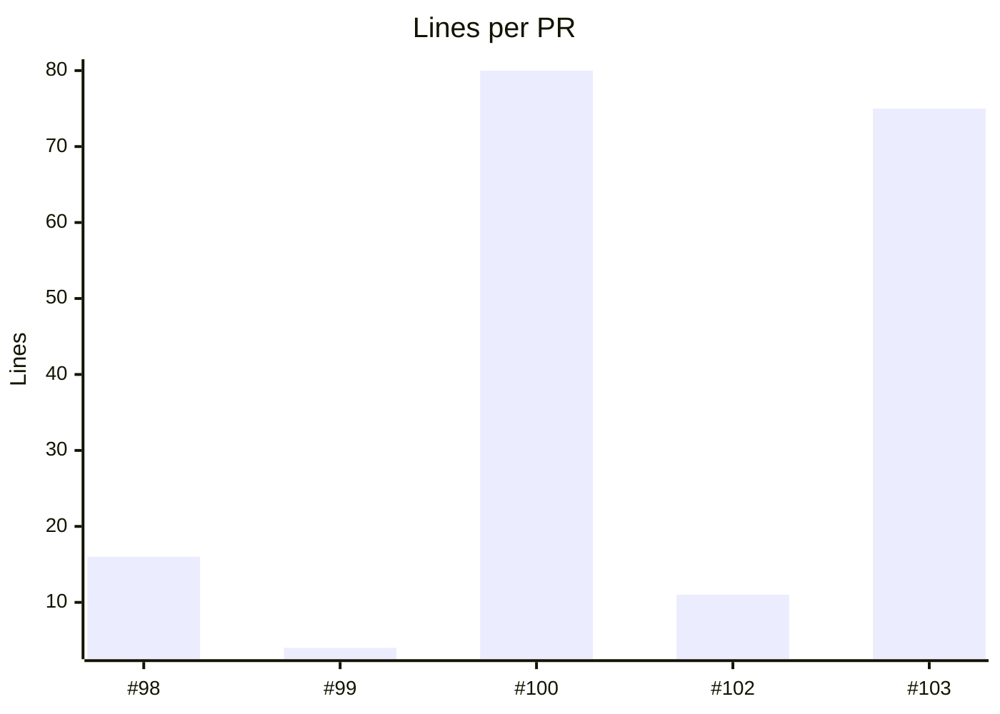
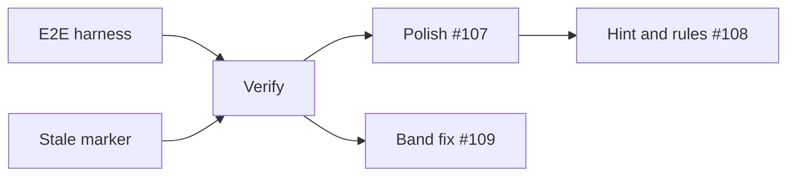

Done. Every renderer feature shows below.

# Renderer check

| State | Feature | Who |
| --- | --- | --- |
| Done, live since [#86](https://github.com/wendelinwemhoener/agent-tooling/pull/86) | Fitted tables with state colors and rows spaced when they are hard to follow | — |
| Running since 02:00Z | Charts te#1774 | — |
| Blocked on review | Alerts | You: reload |

## Compact table

| Skills at | Skills | Words |
| --- | ---: | ---: |
| 10-25 start | 13 | 11,745 |
| 10-26 peak | 15 | 13,989 |
| Now | 9 | 5,555 |

> A plain quote stays as the engine draws it.

> [!NOTE]
> Note body text.

> [!TIP]
> Tip body text.

> [!IMPORTANT]
> Important body text.

> [!WARNING]
> Warning body text.

> [!CAUTION]
> Caution body text.

## Charts



```mermaid
gantt
  title Renderer PRs
  dateFormat YYYY-MM-DD HH:mm
  section Tables
  Row spacing #98 :done, 2026-10-26 23:50, 2026-10-26 23:56
  Progress #102   :done, 2026-10-27 02:28, 2026-10-27 02:33
  section Layout
  Alerts #103     :crit, done, 2026-10-27 02:35, 2026-10-27 02:44
  You: approve, merge :done, 2026-10-27 02:44, 2026-10-27 02:50
```



## Message

The full report: `! open ~/agent-work/guide/demo.html`.

The note for #updates:

```draft
**Renderer:** tables fit the column, charts draw as pictures.

- Alerts are boxes
```

The note for Kei:

```draft
Paper restarts at 10:00Z.
```

🔴 **Needs you:**
1. **Reload the renderer:** run `/reload-plugins`. "reloaded" (recommended) or "later".
2. **Keep the demo:** keep this reply as the test fixture. "keep" (recommended) or "drop".
3. **Where glue goes.** Recommended: `fair/`, as FAIR2's runtime. Alternative: `interface/`, as you sketched.
```draft
glue in fair/
```
```draft
glue in interface/
```
4. **Restart paper?** "go: restart paper" (recommended) or "not now".
